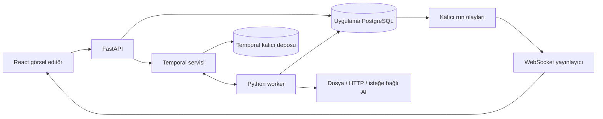

# FlowForge — Ayrıntılı Ürün ve Geliştirme Planı

**Hazırlanma tarihi:** 16 Ekim 2026  
**Proje sahibi:** Berkay Özdemir / berkayozdmr21  
**Güncel durum (17 Ekim 2026):** Çalışan yerel ürün kapsamı uygulandı. Güncel özellikler ve gelecek kapsam README.md ile DELIVERY_STATE.md içinde. Aşağıdaki bölümler özgün geliştirme planını korur.  
**Devam komutu:** “FlowForge'a başlayalım” veya bu projeyi belirterek “başlayalım”.

> Kullanıcının 17 Ekim 2026 başlama talimatıyla geliştirmeye geçildi. Yedi çalışan bloklu yerel sürüm hazırlandı; ileri seviye bağlantılar ve ekip özellikleri gelecek kapsamdır. Bu dosya tasarım geçmişidir; güncel teslim için README.md esas alınır.

## 1. Ürün ne yapacak?

FlowForge, kullanıcıların blokları birbirine bağlayarak otomasyon tasarladığı ve bu otomasyonları sunucuda gerçekten çalıştırdığı bir web uygulaması olacak. Görsel editör, çalıştırma motoru, canlı sonuç ekranı ve geçmiş kayıtları aynı üründe birleşecek.

Örnek kullanım:

**Veriyi gir → boş kayıtları temizle → koşulu kontrol et → ilgili işlemleri çalıştır → rapor indir.**

İleri sürümde:

**Webhook geldi → HTTP üzerinden veri al → AI ile sınıflandır → sonuçları birleştir → rapor oluştur.**

Blokların çalışıyor görünmesi tek başına yeterli değildir. Her çalıştırmanın gerçek girdisi, çıktısı, hata durumu ve kalıcı kaydı bulunacak. Animasyonlar bu gerçek durumları gösterecek.

## 2. Hedef ve başarı ölçütü

GitHub ve CV için hem görsel kalitesi hem mühendislik derinliği olan bir ürün hazırlanacak. Proje şu becerileri gösterecek:

- TypeScript ile karmaşık etkileşimli arayüz geliştirme.
- Grafik veri yapıları, döngü tespiti ve bağımlılık çözümleme.
- Python backend, doğrulama ve veritabanı tasarımı.
- Asenkron işler, paralellik, tekrar deneme ve iptal yönetimi.
- Canlı olay akışı, yeniden bağlanma ve çalıştırma geçmişi.
- Otomatik testler, Docker ve anlaşılır teknik dokümantasyon.

Tamamlanma ölçütü: Kullanıcı hazır bir akışı açıp değiştirebilmeli, çalıştırabilmeli, sonuçları görebilmeli, raporu indirebilmeli ve sayfayı yenilediğinde kayıtlı akışına ulaşabilmeli.

## 3. Kapsamı iki teslimata ayırma

### Teslimat A — Çalışan temel ürün

Öncelikli hedef budur. Yarım saate tamamlanacağına ilişkin bir taahhüt yoktur; işler kabul kriterleriyle ilerler.

- Profesyonel görsel editör ve beş gerçek blok türü.
- Blok ekleme, bağlantı oluşturma/silme, taşıma, yakınlaştırma, mini harita.
- Blok ayar paneli ve girdi doğrulama.
- Sunucuda akış doğrulama ve çalıştırma.
- Canlı blok durumları, olay günlüğü ve çıktı önizlemesi.
- PostgreSQL üzerinde akış, sürüm ve çalıştırma kaydı.
- Temporal ile arka plan yürütme; ikinci, geçici bir yürütme motoru yazılmayacak.
- Akış JSON içe/dışa aktarma.
- JSON, CSV ve statik HTML raporu indirme.
- Üç anahtarsız örnek akış.
- Manuel çalıştırma, iptal ve yeni bir çalıştırma olarak yeniden deneme.
- İlk sürüm localhost ve tek kullanıcı çalışma alanına yönelik olacak.

### Teslimat B — Gelişmiş platform

- Katalogda toplam on blok türü.
- Gerçek HTTP, dosya girişi ve isteğe bağlı AI bağlantısı.
- Webhook tetikleme ve zamanlanmış çalıştırmalar.
- Kullanıcı hesapları, ekip çalışma alanları ve yetkilendirme.
- Sürüm geçmişini karşılaştırma ve eski sürümü yeni taslak olarak açma.
- Eşzamanlı çalışma limitleri, maliyet/kota kontrolleri ve gelişmiş gözlemleme.

### İlk kapsamın dışında

Rastgele Python/JavaScript çalıştırma, sonsuz döngü blokları, binlerce hazır entegrasyon, ortak imleçlerle eşzamanlı editör, mobilde masaüstüyle aynı sürükleme deneyimi, Kubernetes ve ücretli abonelik sistemi ilk teslimata dahil değildir.

## 4. Teknoloji kararı

| Katman | Tercih | Neden |
| --- | --- | --- |
| Arayüz | React + TypeScript + Vite | Etkileşimli editör ve ayrı API için uygun temel |
| Grafik editörü | React Flow / @xyflow/react | Özel bloklar, bağlantı noktaları, pan/zoom ve mini harita |
| Editör durumu | Zustand | Grafik, seçim ve geçmişi yönetme |
| API verisi | TanStack Query | Kayıtlar, sorgular ve sunucu durumu |
| API | FastAPI + Pydantic | Tipli istekler, doğrulama, API belgeleri |
| Uygulama veritabanı | PostgreSQL + SQLAlchemy + Alembic | Kalıcı kayıt ve şema geçişleri |
| Yürütme | Temporal + Python SDK worker | İşlerin süreç kesintilerinden sonra devam etmesi |
| Canlı iletişim | WebSocket + kalıcı olay tablosu | Yeniden bağlanınca kaçırılan olayları tamamlama |
| Test | Vitest, Testing Library, pytest | Arayüz, alan mantığı ve backend kontrolleri |
| Dağıtım | Docker Compose + GitHub Actions | Tekrarlanabilir kurulum ve CI |

Başlangıçta Redis, Kafka ve ayrı bir mesajlaşma sistemi eklenmeyecek. Gerekirse gerçek yük ölçümleri sonrasında değerlendirilir. Paket sürümleri uygulamaya başlanırken resmi belgeler ve uyumluluk üzerinden seçilip lock dosyalarıyla sabitlenecek.

Temporal uygulama veritabanının yerine geçmez. Akışlar ve ürün kayıtları uygulama veritabanında, yürütme geçmişi Temporal'da tutulur. Temporal'ın kendi veritabanı/şeması uygulama tablolarından ayrılır.

## 5. Sistem mimarisi



API hızlı cevap verir; uzun işler API isteğinin içinde çalıştırılmaz. Run oluşturulunca 202 ve run kimliği döner. Worker blokları işler. Arayüz sonuçları API ve olay akışından alır. Tarayıcı kapansa da yürütme devam eder.

### Akışı başlatırken tutarlılık

API, run kaydını ve `start_requested` outbox kaydını tek veritabanı işlemiyle yazar. Dispatcher bekleyen outbox işlerini Temporal'a gönderir. Temporal workflow kimliği run kimliğinden türetilir. Dispatcher yeniden denerse aynı run için ikinci workflow oluşturulmaz. Ağ hatasında run'ın sonsuza kadar `queued` kalmasını önlemek için uzlaştırma görevi bulunur.

### Worker sınırı

Temporal Workflow kodu yalnızca belirlenimci orkestrasyonu yapar. HTTP, dosya okuma/yazma, AI çağrıları ve uygulama veritabanı işlemleri Activity içinde yapılır. SDK dışındaki saat, rastgelelik ve ağ işlemleri Workflow koduna konulmaz.

## 6. Ekran tasarımı

### Ana çalışma alanı

- Sol: arama, blok kategorileri, hazır akışlar.
- Orta: koyu grafit tuval, ince noktalı grid, bağlantılar, mini harita.
- Sağ: seçili bloğun ayarları, port bilgileri ve doğrulama hataları.
- Üst: akış adı, kayıt durumu, sürüm, çalıştır ve iptal düğmeleri.
- Alt: açılıp kapanabilen log / girdi / çıktı / hatalar paneli.

Editörün geniş görünümünde yan paneller kapatılabilir. Küçük ekranlarda ayar paneli çekmeceye dönüşür. Metin boyutları ve tıklama alanları kullanılabilir kalır; çok yoğun tuval düzenlemesi masaüstüne öncelik verir.

### Görsel dil ve animasyon

Grafit zemin, kırık beyaz metin, mor/mavi vurgu ve duruma bağlı yeşil/kırmızı tonlar. Çalışan blokta yumuşak ışık, etkin bağlantıda ilerleyen veri noktaları, başarılı blokta kısa onay geçişi. Başarısız blokta hata göstergesi ve açık bir açıklama.

Boşta duran bütün bağlantılar sürekli hareket etmeyecek. Animasyonlar gerçek `run/node` durumuna bağlı olacak. Azaltılmış hareket tercihinde veri parçacıkları ve kamera benzeri geçişler kapanacak; durum değişimleri metin ve ikonlarla görünür kalacak.

### Diğer ekranlar

Akış listesi; çalıştırma geçmişi; tek çalıştırmanın zaman çizelgesi; hazır şablonlar. İleri sürümde bağlantılar/anahtarlar, ekip üyeleri ve ayarlar.

## 7. Blok kataloğu

| Tür | Aşama | Girdi ve davranış | Çıktı |
| --- | --- | --- | --- |
| manual_input | A | JSON verisi veya hazır örnek seçimi | Veri zarfı |
| transform | A | Alan seçme/yeniden adlandırma, trim, boşları çıkarma, filtre, tekrarları temizleme | Yeni veri zarfı |
| condition | A | Alan veya kayıt sayısı üzerinde tanımlı karşılaştırma | Etkin `true` veya `false` portu |
| merge | A | Etkin kolların bitmesini bekleyip kayıtları birleştirme | Birleştirilmiş kayıtlar |
| report | A | Kayıtlar ve sabit rapor ayarları | JSON / CSV / HTML dosyaları |
| file_input | B | Sınırlandırılmış CSV/JSON yükleme; Excel daha sonra | Ayrıştırılmış kayıtlar |
| http_request | B | İzin verilen HTTP hedefi, süre limiti ve tipli ayarlar | Sınırlı JSON yanıtı |
| ai_analyze | B | Sağlayıcı bağlantısı ve yapılandırılmış analiz talimatı | Şeması doğrulanmış analiz |
| delay | B | İptal edilebilir, kalıcı bekleme | Girdinin aynısı |
| aggregate | B | Grup, sayım, toplam, ortalama gibi hazır işlemler | Özet kayıtları |

`transform` kullanıcı kodu çalıştırmaz. İşlemler izinli bir DSL/listeden seçilir. `condition` için `eval` kullanılmaz. Webhook ve zamanlama birer akış başlatma mekanizmasıdır; katalogdaki on bloktan ayrı ele alınır.

## 8. Veri ve bağlantı sözleşmesi

### Veri zarfı

Her blok çıktısı `schemaVersion`, `records`, `meta` ve gerekirse dosya referansları taşır. `records` bir JSON nesneleri listesidir; `meta` kaynak, adet ve oluşturulan özet bilgilerini içerir. Büyük içerikler doğrudan olay mesajlarına veya Temporal geçmişine konulmaz; blob/artifact kimliğiyle taşınır.

### Akış belgesi

Belge sürümü, akış kimliği, ad, düğümler, kenarlar ve yalnızca arayüze ait görünüm verisi bulunur. Her düğümde `id`, `type`, `typeVersion`, ayarlar ve konum vardır. Kenar; kaynak düğüm/port ve hedef düğüm/port kimliklerini taşır. Parola ve API anahtarı belgede bulunmaz; yalnızca connection referansı taşınır.

### Grafik doğrulama

- İlk sürümde tek giriş düğümü: `manual_input`; ileri sürümde alternatif `file_input`.
- Çalıştırılabilir düğümler girişten erişilebilir olmalı.
- Kendi kendine bağlantı ve yönlü döngü reddedilir; Kahn algoritması veya DFS kullanılır.
- Kaynak/hedef portları ve veri tipleri uyumlu olmalı.
- Aynı kenar iki kez eklenemez; kimlikler benzersiz olmalı.
- `merge` dışındaki işlem düğümleri en fazla bir giriş bağlantısı kabul eder.
- `condition` çıkışları `true` ve `false` olarak açıkça ayrılır.
- Birden fazla rapor çıkışı olabilir; en az bir terminal çıktı düğümü gerekir.
- Bilinmeyen blok türü/sürümü ve geçersiz ayarlar reddedilir.

Arayüz bağlantı anında yardım eder; API aynı kuralları bağımsız olarak tekrar uygular. Editördeki konumlar çalıştırma sırasını belirlemez.

## 9. Koşul, paralellik ve birleşme semantiği

Koşul tüm girdi üzerinde tek karar üretir. Örneğin `records.count > 0` ise `true` portu etkinleşir. Satır satır ayırma, `transform` filtreleriyle yapılır; iki davranış karıştırılmaz.

Seçilmeyen kol `skipped` olarak yayılır. Bu bir hata değildir. Boş kayıt listesi de hata değildir; seçilmiş bir kol boş listeyle başarıyla tamamlanabilir.

Bağımsız hazır düğümler belirlenen paralellik limiti içinde çalışır. `merge`, tüm girişlerinin terminal duruma gelmesini bekler, başarılı ve etkin kollardan veri toplar. `skipped` kolları yok sayar. Bütün kollar atlanmışsa kendisi de atlanır. Zorunlu bir kol başarısızsa varsayılan politika run'ı başarısız bitirmek ve bağımlı düğümleri `blocked` yapmaktır.

Birleştirme sırası hızdan etkilenmez: giriş portu/kenar sırasına göre belirlenir. Böylece paralel işler farklı sırayla bitse de sonuç tutarlı olur.

## 10. Çalıştırma yaşam döngüsü

Run: `queued → running → succeeded | failed | cancelled`. İptal sırasında geçici `cancelling` olabilir.

Düğüm: `pending → ready → running → succeeded | failed | skipped | cancelled | blocked`. Tekrar denemede `retry_wait` ara durumu gösterilir. Her Activity denemesi ayrıca kaydedilir.

1. Kullanıcı çalıştırmayı ister; varsa kaydedilmemiş değişiklikler önce açıkça sürümlenir.
2. API grafik ve blok ayarlarını doğrular.
3. Değişmez akış sürümü, girdi özeti ve run kaydı oluşturulur.
4. Outbox üzerinden Temporal workflow başlatılır.
5. Scheduler hazır düğümleri belirler ve Activity'leri başlatır.
6. Activity sonuçları ve olayları kalıcı kayda yazılır.
7. Arayüz blok renklerini ve çıktı panelini günceller.
8. Run terminal duruma geçer; rapor bağlantıları görünür.

Çalışan run, editörde sonradan yapılan değişiklikleri kullanmaz. “Yeniden çalıştır”, eski kaydı değiştirmek yerine yeni run açar; kullanılan sürüm ve girdi açıkça seçilir.

## 11. Tekrar deneme, iptal ve kesinti

Geçici bağlantı hataları, zaman aşımı ve belirli servis hataları sınırlı sayıda, artan beklemeyle yeniden denenebilir. Geçersiz girdi, eksik anahtar ve yetkisiz istekler otomatik tekrar döngüsüne sokulmaz. Her blok türünün süre ve retry politikası açıkça tanımlanır.

Activity yürütmesi birden fazla kez gerçekleşebilir. “Her dış işlem kesinlikle bir kez olur” sözü verilmeyecek. Yan etkili işlemler için run + node + mantıksal işlem kimliğinden sabit idempotency anahtarı türetilir; retry denemesi anahtarı değiştirmez. Hedef servis bu mekanizmayı desteklemiyorsa olası tekrar etkisi açıkça belirtilir.

İptal, Temporal cancellation mekanizmasıyla iletilir. Uzun Activity'ler heartbeat ve işbirlikçi iptal kullanır. Ağda tamamlanmış bir dış işlem otomatik geri alınmış sayılmaz. İptal ve başarı aynı anda yarışırsa son durum veritabanında koşullu güncelleme ile tutarlı tutulur.

Worker kapanınca orkestrasyon geçmişi korunur. Activity sonucunun kaydı ile dış etki arasındaki kesinti idempotency ile ele alınır. API/worker yeniden başladıktan sonra ekran run durumunu yeniden sorgular; animasyonlar run'ın yeniden başlatıldığı anlamına gelmez.

## 12. Canlı olaylar

Her olay; `run_id`, artan `sequence`, `event_id`, zaman, tür, isteğe bağlı node/attempt kimliği ve küçük bir payload taşır. Örnek türler: `run.started`, `node.started`, `node.retrying`, `node.succeeded`, `node.failed`, `node.skipped`, `run.completed`.

Olaylar önce veritabanına yazılır. WebSocket yayıncısı bunları iletir. İstemci son sequence değerini tutar; yeniden bağlanırken `after_sequence` ile eksikleri ister ve `event_id` üzerinden tekrarları ayıklar. Sayfa ilk açıldığında run snapshot'ı ile olay sınırı tutarlı alınır; snapshot ile abonelik arasındaki olaylar kaybolmaz.

İlk sürümde olay tablosunu kısa aralıklarla sorgulayan yayıncı yeterlidir. Çoklu API örneğine geçildiğinde fan-out ihtiyacı ayrıca tasarlanır; bellekteki tek bir kuyruk kalıcı olay kaynağı sayılmaz.

## 13. Veritabanı taslağı

| Tablo | Ana içerik |
| --- | --- |
| workspaces | Tek kullanıcı çalışma alanı; ileride ekip |
| workflows | Ad, sahip çalışma alanı, güncel taslak referansı |
| workflow_versions | Değişmez grafik JSON'u, belge hash'i, sürüm numarası |
| runs | Sürüm, durum, girdi referansı, Temporal kimliği, zamanlar |
| node_runs | Run + node, durum, çıktı referansı, süre |
| node_attempts | Deneme numarası, hata sınıfı, başlangıç/bitiş |
| run_events | Run + sequence benzersiz, olay türü ve payload |
| artifacts | Dosya türü, boyut, hash ve depolama anahtarı |
| outbox | Başlatma niyeti, gönderim durumu ve tekrar bilgisi |
| connections | İleri sürümde şifreli sağlayıcı bağlantıları |
| schedules | İleri sürümde zamanlama, saat dilimi, etkinlik |
| users / memberships | İleri sürümde hesaplar ve roller |

Sürüm numarası, olay sırası ve node/attempt kimlikleri uygun unique kısıtlarla korunur. Kayıt güncellemelerinde optimistic concurrency/version kontrolü uygulanır; eski bir tarayıcı yeni taslağın üstüne sessizce yazamaz.

## 14. API taslağı

| İşlem | Endpoint |
| --- | --- |
| Hazırlık/sağlık | GET /api/health/live ve /api/health/ready |
| Blok şemaları | GET /api/node-types |
| Akış listesi/oluşturma | GET / POST /api/workflows |
| Akış okuma/taslak güncelleme | GET / PATCH /api/workflows/{id} |
| Sürüm oluşturma/listeleme | POST / GET /api/workflows/{id}/versions |
| Grafiği doğrulama | POST /api/workflows/validate |
| Run başlatma | POST /api/workflows/{id}/runs |
| Run geçmişi/detayı | GET /api/runs ve /api/runs/{id} |
| Run iptali | POST /api/runs/{id}/cancel |
| Olayları tamamlama | GET /api/runs/{id}/events?after_sequence=... |
| Canlı abonelik | WS /api/runs/{id}/stream |
| Rapor indirme | GET /api/artifacts/{id}/download |

Run başlatmada istemci idempotency anahtarı gönderir. Aynı anahtar aynı istek gövdesiyle gelirse mevcut run döner; farklı gövdeyle yeniden kullanım çakışma hatası verir. Hata cevabı standart `code`, kullanıcıya uygun `message` ve alan bazlı `details` taşır.

## 15. Anahtarlar ve dış bağlantılar

İlk teslimat API anahtarı olmadan gerçek veri dönüşümü ve rapor üretimi yapacak. AI modülü ileri aşamada eklenir. Anahtar yoksa “bağlantı gerekli” durumu gösterilir; örnek veya kural tabanlı sonuçlar gerçek model yanıtı gibi sunulmaz.

Geliştirmede `.env.example` yalnızca değişken adlarını içerir. Gerçek `.env` Git'e girmez. Anahtarlar tarayıcı paketine, localStorage'a, paylaşılan grafik JSON'una veya loglara yazılmaz. Paylaşılan çalışma alanı sürümünde connection sırları sunucuda şifreli saklanır; şifreleme anahtarı veritabanı dışında tutulur.

AI bloklarında sağlayıcı/model seçimi, harcama sınırı ve yapılandırılmış çıktı şeması bulunur. Sağlayıcı API ayrıntıları bu planın ardından uygulamaya başlanırken resmi belgelerle ayrıca doğrulanacak.

## 16. Uygulama sınırları ve veri koruması

İlk önerilen limitler, uygulama sırasında ölçülerek ayarlanmak üzere: akış başına 100 düğüm/200 kenar; run başına 4 eşzamanlı Activity; doğrudan JSON girdisi 1 MB; dosya girdisi 10 MB; inline sonuç 256 KB; olay payload'ı 16 KB. Büyük sonuçlar artifact depolamaya taşınır.

HTTP bloğu eklendiğinde localhost, özel ağlar, link-local/metadata hedefleri ve yönlendirmeler üzerinden SSRF engellenir. DNS çözümü, yönlendirmeler ve bağlantı hedefi birlikte kontrol edilir. Geliştirme fixture sunucusu istisnası yalnızca test ortamında açıkça yapılandırılır.

Dosya adları depolama yolu olarak kullanılmaz; tip, boyut ve içerik kontrol edilir. HTML raporunda kullanıcı verisi escape edilir. CSV dışa aktarımında elektronik tablo formül enjeksiyonuna karşı hücre içerikleri güvenli biçimde üretilir.

Tek kullanıcılı ilk sürüm varsayılan olarak loopback'e bağlanır. İnternete açık kullanım için kimlik doğrulama, workspace izolasyonu, origin kontrolleri, kota ve TLS tamamlanmadan “üretime hazır çok kullanıcılı servis” denmez.

## 17. İlk üç hazır akış

### Veri kalite raporu

Manual input → transform (trim, boşları çıkar, tekrarları temizle) → report. Örnek müşteri kayıtları ve önce/sonra adetleri gösterilir.

### Eşik kontrollü işlem

Manual input → condition (kayıt sayısı > 0) → true kolunda transform, false kolunda boş sonuç transform'u → merge → report. Atlanan kol ve birleşme semantiğini gösterir.

### İki paralel görünüm

Manual input → iki bağımsız transform (örneğin yüksek ve düşük tutarlı satışlar) → merge → report. Gerçek paralellik, stabil birleşme sırası ve iki ayrı node çıktısı izlenir.

Bu üç şablon Teslimat A'nın beş bloğuyla çalışır ve dış servis gerektirmez. AI yorum analizi ve HTTP değişiklik takibi Teslimat B şablonları olarak sonradan eklenir.

## 18. Önerilen klasör yapısı

Aşağıdaki ağaç gelecekte oluşturulacak; bu plan hazırlanırken uygulama dosyaları oluşturulmayacak.

```text
flowforge/
  frontend/
    src/components/editor/
    src/components/nodes/
    src/features/workflows/
    src/features/runs/
    src/stores/
    src/lib/
    src/styles/
  backend/
    app/api/
    app/domain/graph/
    app/domain/nodes/
    app/models/
    app/services/
    app/realtime/
    app/worker/
    migrations/
    tests/
  shared/schemas/
  examples/
  docs/
  compose.yaml
  .env.example
  .github/workflows/ci.yml
  README.md
```

JSON Schema/OpenAPI sözleşmelerinden mümkün olduğunca ortak tipler üretilecek. Frontend ve backend ayrı ayrı çelişen blok tanımları tutmayacak; node registry API'si editör ayarlarını besleyecek.

## 19. Geliştirme sırası ve kabul kapıları

### A1 — Sözleşme ve iskelet

Grafik JSON şeması, veri zarfı, durumlar, node registry ve örnek belgeler hazırlanır. Vite/TypeScript, FastAPI, PostgreSQL ve Temporal Compose ortamı kurulur. Sağlık endpoint'leri servis bağımlılıklarını doğru raporlar.

**Kabul:** Servisler açılır; örnek belge sunucuda doğrulanır; geçersiz grafik nedenleriyle reddedilir.

### A2 — Gerçek çalışan ince dilim

Manual input → transform → report uçtan uca yapılır. Sürümleme, run/outbox, worker ve artifact indirme bağlanır. Editör ilk anda yalnızca bu dar akışı çalıştırsa bile çıktı gerçek olur.

**Kabul:** Tarayıcıdan başlatılan run gerçek çıktı dosyası üretir; sonuç veritabanında kalır.

### A3 — Editör ve beş blok

Koşul/birleşme ve paralellik eklenir. Bağlantı doğrulama, ayar paneli, seçim, kopyalama, silme, undo/redo ve JSON içe/dışa aktarma tamamlanır. Bir sürükleme tek undo adımı olur.

**Kabul:** Üç örnek akış çalışır; cycle ve port hataları hem UI hem API'de yakalanır.

### A4 — Canlı durum ve dayanıklılık

Olay sıraları, WebSocket reconnect, retry politikaları, iptal ve worker kesintisi senaryoları tamamlanır.

**Kabul:** Sayfa yenilenince olaylar tamamlanır; worker kesintisinden sonra işlem tutarlı şekilde devam eder; retry denemeleri ayrı görünür.

### A5 — Görsel kalite ve teslim

Animasyonlar gerçek run durumuna bağlanır. Boş/hata/yükleniyor durumları, erişilebilirlik, dar ekranlar ve azaltılmış hareket kontrol edilir. README, gerçek ekran görüntüleri, örnekler ve CI hazırlanır.

**Kabul:** Temiz kurulumdan çalışır; gerekli test ve build geçer; belgeler gerçek özelliklerle eşleşir.

### B1–B3 — Genişletme

Önce file/aggregate/delay; sonra güvenli HTTP ve isteğe bağlı AI; ardından webhook/schedule ve hesap/ekip sistemi. Her grup kendi testleri ve kabul kriterleriyle tamamlanır. Sırf kapsamı doldurmak için çalışmayan bloklar kataloğa eklenmez.

## 20. Test planı

### Alan mantığı

Döngü ve self-edge; erişilemeyen node; yanlış port; bilinmeyen tür/sürüm; farklı bitiş sıralarında aynı merge çıktısı; koşulun atlanan kolu; boş girdi; düğüm/kenar limitleri; transform'un girdiyi yanlışlıkla değiştirmemesi.

### API ve veritabanı

Sürümün değişmezliği; çalışırken taslak değişikliği; aynı idempotency anahtarıyla tekrar başlatma; outbox kesintisi; hatalı artifact erişimi; eşzamanlı taslak güncelleme; node ayarı doğrulama; ileri aşamada workspace izolasyonu.

### Yürütme entegrasyonu

Gerçek Temporal test ortamında worker'ı Activity öncesi/sonrası durdurma; geçici ve kalıcı hataları ayırma; sınırlı retry; heartbeat; iptal yarışı; rapor üretiminde tekrar denemenin aynı mantıksal artifact'i çoğaltmaması.

### Arayüz

Blok ekle/bağla/sil; ayar değiştir; undo/redo; run durumlarını göster; canlı olay tekrarlarını ayıkla; reconnect sonrası kaçan olayı tamamla; geçmiş run'ın yeni taslakla karışmaması.

### Tarayıcı kabulü

Üç şablonu baştan sona çalıştır; rapor önizleme ve indirme bağlantısını kontrol et; run sırasında sayfayı yenile; ağ bağlantısını kesip geri getir; uzun bir işi iptal et; reduced-motion ve dar ekran kontrollerini yap. Ekran görüntüsü veya animasyon tek başına backend çalıştığının kanıtı sayılmaz.

Test sayısı şimdiden vaat edilmeyecek. Gereksinimlerin anlamlı testlerle kapsanması esas alınacak; geçmeyen kontroller teslimde açıkça yazılacak.

## 21. Çalıştırma ve GitHub teslimi

İlk hedef Docker Compose ile tekrarlanabilir kurulum. API, worker, uygulama PostgreSQL'i ve Temporal bileşenleri healthcheck ile başlatılır. Başarısız servis durumunda açıklayıcı hata gösterilir. Host portları ayarlanabilir olur; önceki projelerin kullandığı 8000/8980 portlarına sabit bağımlılık kurulmaz.

Docker olmayan kullanım ayrıca değerlendirilecek; Temporal/PostgreSQL bağımlılıkları gizlenerek “yalnızca çift tıkla” iddiası kurulmayacak. Windows başlatma yardımcı dosyası eklenirse ön koşulları kontrol edip doğru komutu çalıştıracak.

GitHub'a ancak uygulama gerçekten hazır olduğunda ve kullanıcı yayınlamayı istediğinde yüklenecek. Önerilen repo adı `flowforge`; uygunluğu o anda kontrol edilecek. Kullanıcının önceki tercihi public repo ve geliştirici olarak yalnızca kendi hesabıdır; yayınlama anında geçerli talimat esas alınır.

README; ürün amacı, gerçek ekran görüntüleri, özellikler, şablonlar, kurulum, mimari, testler, anahtarsız kullanım ve bilinen sınırları içerecek. Gerçek sırlar, çalışma veritabanı, kişisel yüklemeler ve sanal ortamlar repoya girmeyecek. Asistan/Codex/OpenAI için katkıcı veya co-author kredisi eklenmeyecek.

## 22. Başladığımızda izlenecek ilk adımlar

1. Bu dosyayı oku ve kullanıcının varsa yeni kapsam değişikliklerini uygula.
2. Çalışma klasörünü, mevcut servisleri ve portları kontrol et; başka projelerin dosyalarını değiştirme.
3. Resmi belgelerden seçilen bağımlılık sürümlerini ve Temporal yerel kurulumunu doğrula.
4. Teslimat A'yı esas al; A1 ve A2 ile gerçek çalışan bir uçtan uca akış çıkar.
5. Sonra editör ve kalan blokları tamamla; yalnızca maket arayüzle teslim etme.
6. Gerekli testleri, build'i ve mümkünse tarayıcı kontrollerini tamamla.
7. Durumu dürüstçe bildir: çalışan özellikler, kalan işler ve bilinen sınırlar.

**17 Ekim 2026 güncellemesi:** Planın yerel ürün kapsamı uygulandı, test edildi ve paketlendi. GitHub yayını ayrıca istenmediği için bu proje için henüz yapılmadı. Otomatik veya zamanlanmış bir başlangıç yoktur.

## 23. Resmi kaynaklar

Bu planın teknik dayanakları 16 Ekim 2026 tarihinde kontrol edildi; uygulama başlangıcında sürüm ayrıntıları yeniden doğrulanmalı. Yukarıdaki ürün kapsamı ve limitler proje için önerilen tasarım kararlarıdır, kütüphanelerin zorunlu kuralları değildir.

- [React Flow — Custom Nodes](https://reactflow.dev/learn/customization/custom-nodes): özel node ve portlu editör temeli.
- [React Flow — Validation](https://reactflow.dev/examples/interaction/validation): bağlantı doğrulaması için örnek API.
- [React Flow — Save and Restore](https://reactflow.dev/examples/interaction/save-and-restore): grafik verisini kaydetme/geri yükleme örneği.
- [Temporal — Python SDK guide](https://docs.temporal.io/develop/python): Python Workflow, Activity ve Worker geliştirme rehberi.
- [Temporal — Workflows](https://docs.temporal.io/workflows): kalıcı orkestrasyon ve Workflow/Activity ayrımı.
- [Temporal — Python error handling](https://github.com/temporalio/documentation/blob/main/docs/develop/python/best-practices/error-handling.mdx): hata sınıflandırma, retry ve idempotent Activity yaklaşımı.
