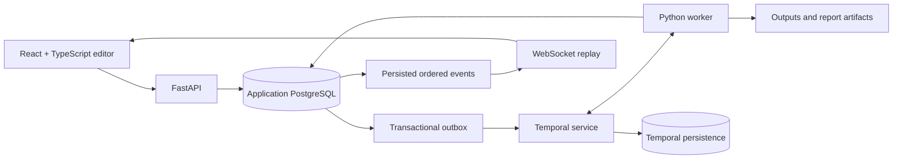

# FlowForge

**Make work flow.** A visual automation studio built by **Berkay Özdemir**.

Design workflows on a canvas, execute them with a real durable worker, inspect every step, and download the results. A warm paper-and-olive interface keeps the workspace quiet while live node states make execution easy to follow.

**React 19 · TypeScript · React Flow · FastAPI · PostgreSQL · Temporal**


## What works

- Seven executable node types: **JSON input, transform, condition, merge, report, durable delay and aggregation**.
- A visual graph editor with typed ports, connection validation, mini map, zoom, node settings, duplication and deletion.
- A connection dialog as an alternative to dragging ports.
- Undo/redo, one history entry per completed drag, and browser draft persistence.
- Three executable templates: data quality, conditional routing and parallel sales analysis.
- Server-side cycle detection, reachability checks, port validation and configuration schemas.
- Real Temporal workflows and Activities, up to four concurrent ready nodes per run, bounded retries and cancellation.
- Immutable workflow versions, optimistic draft updates and idempotent run creation.
- PostgreSQL transactions, an outbox dispatcher and ordered, persisted run events.
- WebSocket updates with cursor-based replay after reconnects.
- Run history, node output previews, attempt history and JSON workflow import/export.
- Server-generated **JSON, CSV and HTML** reports with safe escaping.
- Reduced motion, keyboard shortcuts and collapsible work panels.

All seven blocks work without API keys. There are no simulated AI responses. Provider connections, HTTP/file ingestion, webhook/scheduled triggers and multi-user/team authorization remain future extensions; this delivery completes the core local-workspace scope in [PROJE_PLANI.md](PROJE_PLANI.md), plus delay and aggregation.

## Try it

1. Open **Hazır şablonlar** and choose **Müşteri verisi**.
2. Select the input node, edit its JSON and click **Girdiyi uygula**.
3. Adjust the transform options or leave the sample defaults.
4. Click **Çalıştır** and inspect the live event log.
5. Open **Raporlar** to download the JSON, CSV or HTML result.

The sample contains fictional records and `.test` email addresses. Cleaning the sample with a required email produces five unique, nonempty records. An empty result is valid data, not an execution error.

## Start on Windows

### Native local stack — verified

Prerequisites: **Python 3.10+ (3.12 recommended)** and an installed **PostgreSQL 17+**. PostgreSQL executables are discovered under `Program Files/PostgreSQL`; set `PG_BIN` to another installation's `bin` directory when necessary.

1. Extract the whole project.
2. Double-click **BASLAT.cmd**.
3. Keep the terminal open. The browser opens only after the API, PostgreSQL and Temporal worker are ready.
4. Stop with **Ctrl+C** in that terminal, or use **DURDUR.cmd**.

The first launch installs Python packages in `.venv` and, if missing, downloads Temporal CLI **1.9.1** from its official GitHub release. Its SHA-256 is checked against the official release checksums. Internet is required for that first setup. The production frontend is included; normal use does not require Node.js.

The launcher starts a project-owned PostgreSQL cluster, a persistent Temporal development server, the API and the worker. It chooses available ports; the editor prefers **9030**. The actual URL is printed and written to `.runtime/current-url.txt`. Runtime files and logs stay under `.runtime`; no existing system database is reconfigured. The native development cluster uses trust authentication on loopback only. Do not expose it on a network.

### Docker Compose

With Docker Desktop running:

```sh
docker compose up --build
```

Open [localhost:9030](http://127.0.0.1:9030). The Temporal UI is at [localhost:8239](http://127.0.0.1:8239). Use `FLOWFORGE_PORT` to change the editor's host port, for example `FLOWFORGE_PORT=9040 docker compose up --build` on a POSIX shell.

`DOCKER_BASLAT.cmd` provides the standard Windows Docker command. Stop containers with `docker compose stop`. PostgreSQL, Temporal state and output artifacts use named volumes. The included password is a development-only container default.

The Compose configuration was validated. Docker execution could not be verified in the development environment because its Docker engine was unavailable; the native stack was exercised end to end.

## Architecture



The API never runs a workflow inside a request. Run creation stores the immutable version, run record and outbox intent atomically. A dispatcher starts a Temporal workflow using a stable run-based ID; repeated dispatch does not create a second workflow. The worker executes independent ready nodes in bounded parallel batches.

Workflow code handles deterministic orchestration. Database operations, transforms and artifact writes happen in Activities. Durable delays use Temporal timers. Large records and outputs are kept outside Temporal history: Activities return compact node/count/port metadata, with detailed data stored in application storage.

### Branches and joins

`condition` makes one decision over its input, e.g. `records.count > 0`. It activates `true` or `false`; the unused branch becomes `skipped`. Row filtering belongs in `transform`.

`merge` waits until every parent is terminal, ignores skipped branches and concatenates active results in edge order. All-skipped joins are skipped. A failed required operation fails the run and blocks remaining work. Empty record arrays are valid.

Activity execution is at least once. Stable output names, artifact IDs and completed-node checks make internal writes safe to repeat. This does not claim exactly-once effects for arbitrary external services.

### Persistence

Application tables: `workflows`, `workflow_versions`, `runs`, `node_runs`, `node_attempts`, `run_events`, `artifacts`, `outbox`. Alembic manages the schema. Drafts use revisions; stale updates return 409. A running job uses its saved version even if the editor draft changes.

Clearing browser storage removes local unsaved drafts, not PostgreSQL saves. Named records, run history and reports remain under project-managed persistent storage. Keep backups of `.runtime` for the native stack or Docker volumes for Compose.

## Node settings

| Node | Configuration |
| --- | --- |
| JSON input | List of JSON objects, up to 10,000 records |
| Transform | Trim, remove empty rows, required field, deduplicate, comparisons, projection and rename |
| Condition | Record count or first-record field, operator and value |
| Merge | Stable concatenation, optional deduplication |
| Report | Title and JSON/CSV/HTML formats |
| Delay | Persistent timer, 0.1–300 seconds, cancellable |
| Aggregate | Group field, numeric field, count/sum/mean |

Transforms use a fixed declarative operation set. There is no `eval`, arbitrary Python block or user-supplied executable code.

## Controls

| Action | Control |
| --- | --- |
| Add node | Click a library item |
| Connect | Drag handles, or use the connection-dialog toolbar button |
| Configure | Select a node |
| Move | Drag the node |
| Pan / zoom | Canvas drag and mouse wheel / controls |
| Undo / redo | Ctrl+Z / Ctrl+Shift+Z |
| Duplicate | Ctrl+D |
| Delete selected node or edge | Delete / Backspace |
| Fit graph | Fit toolbar button |
| Export / import graph | Footer JSON controls |

Keyboard edit shortcuts are disabled in form fields and dialogs. Apply edited JSON explicitly before running. Historical runs open as read-only snapshots; return to the draft to edit, or restore a version as a new draft state.

## API

Open `/docs` for the interactive API. Key endpoints:

| Method | Endpoint | Purpose |
| --- | --- | --- |
| GET | `/api/health/live`, `/api/health/ready` | API liveness and stack readiness |
| GET | `/api/node-types`, `/api/templates` | Shared node schemas and examples |
| GET / POST | `/api/workflows` | List / create drafts |
| GET / PATCH | `/api/workflows/{id}` | Read / optimistic update |
| GET / POST | `/api/workflows/{id}/versions` | Immutable versions |
| POST | `/api/workflows/validate` | Validate a graph |
| POST | `/api/workflows/{id}/runs` | Start a saved version |
| GET | `/api/runs`, `/api/runs/{id}` | History / snapshot |
| POST | `/api/runs/{id}/cancel` | Request cancellation |
| GET | `/api/runs/{id}/events`, `/attempts` | Event replay / attempts |
| WS | `/api/runs/{id}/stream` | Cursor-based live events |
| GET | `/api/runs/{id}/nodes/{node}/output` | Bounded output preview |
| GET | `/api/artifacts/{id}/download` | Download reports |

Writes require `X-Flowforge-Client: studio`. Run creation also requires `Idempotency-Key`. Same-key/same-request returns the same run; different payload reuse returns 409. Cross-origin writes and WebSocket connections are rejected.

## Development and checks

```sh
python -m venv .venv
python -m pip install -r requirements.txt
python -m pytest backend/tests -q
cd frontend
npm ci
npm test
npm run build
```

Run the native launcher with `python run.py` or use Compose. For hot reload, run `npm run dev` in `frontend`; its `/api` proxy expects an API on 9030. Set `DATABASE_URL`, `TEMPORAL_ADDRESS` and optionally `FLOWFORGE_DATA` for separate API/worker processes.

**82 automated checks passed:** 65 backend/domain tests and 17 frontend graph/history tests. Additional real-stack checks exercised all three templates, artifact downloads, a worker restart, cancellation and a permanent failure. See [VERIFICATION.md](VERIFICATION.md).

`scripts/smoke.py`, `scripts/resilience.py` and `scripts/error_smoke.py` exercise a running local stack on 9030. They create clearly named test workflows and runs, so use a development data directory.

## Repository layout

```text
backend/app/domain.py       Node schemas and graph validation
backend/app/operations.py   Pure transforms and report rendering
backend/app/store.py        Application persistence and ordered events
backend/app/workflow.py     Deterministic Temporal orchestration
backend/app/activities.py   Database/file/data Activities
backend/app/worker.py       Worker and outbox dispatcher
backend/app/api.py          HTTP/WebSocket API and static frontend
backend/migrations/        Alembic schema history
backend/tests/             Domain, persistence, API and Activity tests
frontend/src/              Typed React editor and tests
frontend/dist/             Included production frontend
examples/                  Exportable example workflow documents
shared/schemas/            Exported graph and node contracts
run.py                     Native stack supervisor
```

## Limits and honest boundaries

- This is a **single-user local workspace**, not a public multi-tenant service. HTTP access implies access to that workspace. Bind to loopback; add authentication and workspace authorization before public hosting.
- Temporal's persistent **development server** is used locally and in the sample Compose stack. Production deployment needs a separately operated Temporal service and operational hardening.
- 100 nodes / 200 edges per graph, one input, ten open runs, four parallel ready nodes per run, a 1 MB graph limit and a 10 MB node-output limit.
- A run fails rather than pretending a permanent invalid-data error succeeded. Failed and skipped nodes have distinct states.
- Output previews are bounded; report downloads contain full results. HTML is escaped and CSV formula-like strings are neutralized.
- Cancellation is cooperative. Already committed output files or completed operations are not magically rolled back. Only completed report records are offered for download.
- Mobile layouts are available, but dense graph editing is primarily a desktop experience. Direct touch dragging has not been exhaustively device-tested.
- No automatic external messages, provider calls, recurring schedules or GitHub publication are enabled by this project.

## References

The implementation uses original interface/model code and third-party libraries under their own licenses. Google Fonts is optional; system fonts are the fallback. React Flow attribution is retained.

- [React Flow custom nodes](https://reactflow.dev/learn/customization/custom-nodes)
- [Temporal Python SDK](https://docs.temporal.io/develop/python)
- [Temporal CLI / persistent development server](https://docs.temporal.io/cli/setup-cli)
- [Temporal retry and idempotency guidance](https://github.com/temporalio/documentation/blob/main/docs/develop/python/best-practices/error-handling.mdx)
